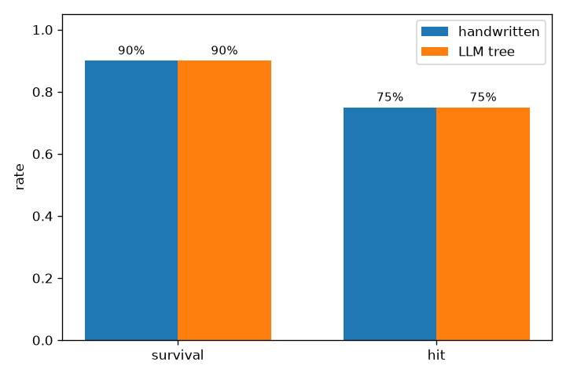
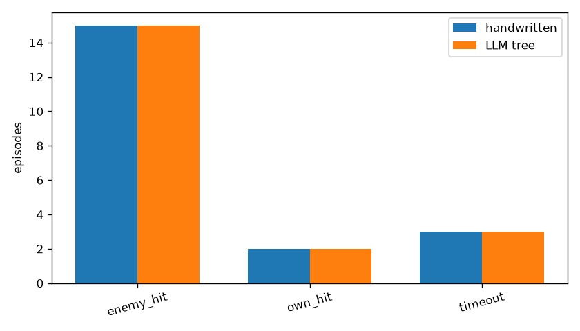
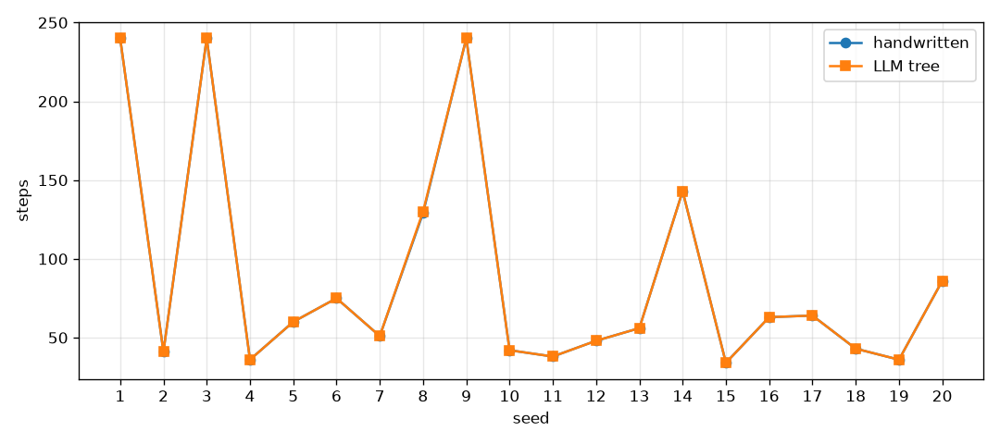

# 阶段二 2.7 行为树仿真验证报告（D2.7-1）

> 日期：2026-11-01　｜　验证对象：手写战术树（2.6）vs LLM 生成树（2.5 在线 Round 1 收敛产物）
> 范围：20 组固定态势 × 2 棵树，同一环境/守卫/引导/步数；不含 DRL 训练、JSRL 训练、2.7 之外的验收。
> 结论：**手写树存活率 90%（18/20，>80%）、安全违规 0、节点 trace 完整性 20/20；两棵树核心指标持平。2.7 技术验证通过，阶段二整体验收待指导教师签字。**

## 1. 目的与方法

### 1.1 目的

1. 用 20 组固定态势验证手写战术树的存活率、命中率、误发射率、安全违规与节点执行覆盖；
2. 在同一口径下对比手写树与 LLM 生成树的性能；
3. 验证节点执行日志（`node_trace`）完整、可追溯；
4. 为阶段二技术总结与阶段三衔接提供数据依据。

### 1.2 统一实验口径

| 项 | 设置 |
|----|------|
| 环境 | `common/bvr_combat_env.py`，JSBSim F-104 1v1，1 Hz 决策 |
| 固定 seeds | 1–20（不修改环境，不补选 seed） |
| 步数 | `max_steps=240`（超时截断） |
| 边界守卫 | 同一 `BoundaryConstraints(env_cfg=env.cfg)`，默认无禁飞区 |
| 引导接口 | 同一 `GuideInterface(max_guide_steps=240)` |
| 录制 | CSV + ACMI + summary + events + node_trace |
| 运行器 | `引导策略行为树/run_2_7_validation.py` |

**手写树**：`llm_bt/tactical_execution_tree.py::tactical_tree_json()`，`bt_tactical_2_6`，OODA 8/8。
**LLM 树**：`docs/assets/2.5_online_r2/bt_final.json`，`bt_v1`，DeepSeek 在线 Round 1 收敛产物（未重新生成、未重新调用 API），OODA 8/8。

## 2. 指标定义

| 指标 | 定义 |
|------|------|
| 存活 | `terminated_reason not in {"own_hit","own_crash"}`；`enemy_hit`/`timeout`/`escape`/`fuel_out` 均计存活 |
| 存活率 | 存活局数 / 20；目标 >80%（≥17/20） |
| 命中率 | `enemy_hit` 局数 / 20 |
| 误发射率 | 下达发射指令时“不在攻击区 / 无余弹 / 未探测目标”的次数 ÷ 发射指令总数；动作层已阻止非法发射则记 0 并给出证据 |
| 安全违规 | 每步 `is_safety_violation(obs, env.cfg)` 累加，目标 0 |
| 静态 OODA 覆盖 | `schema.ooda_coverage(tree)`，8/8 关键节点在树内 |
| 执行 OODA 覆盖 | 本局 `bb.tick_counts` 命中的 OODA 节点数 / 8 |
| 节点 trace 完整性 | step 单调、0..steps-1 无缺失、节点名属于 `ACTIONS`/`CONDITIONS`、至少 1 条 |
| 引导比例 | `guided_steps / steps` |

## 3. 20 组固定态势

实际初始态势由 `env.reset(seed)` 复现；距离 31.17–76.89 km、相对方位 -50.9°~+58.8°、本机高度 9,021–19,462 ft、本机马赫 0.721–0.876，覆盖计划书 30–80 km、±60°、8,000–20,000 ft、M0.7–0.9 区间。

| seed | 距离 km | 方位 ° | 本机高度 ft | 本机 Mach | 手写结局 | LLM 结局 |
|:--:|--:|--:|--:|--:|------|------|
| 1 | 76.89 | -22.6 | 14135 | 0.871 | timeout | timeout |
| 2 | 34.19 | 12.3 | 11132 | 0.744 | enemy_hit | enemy_hit |
| 3 | 58.72 | -48.8 | 9021 | 0.731 | timeout | timeout |
| 4 | 33.60 | 13.1 | 19307 | 0.789 | enemy_hit | enemy_hit |
| 5 | 43.93 | -53.7 | 17652 | 0.846 | enemy_hit | enemy_hit |
| 6 | 48.34 | 58.8 | 14450 | 0.755 | enemy_hit | enemy_hit |
| 7 | 40.81 | -24.2 | 15494 | 0.861 | enemy_hit | enemy_hit |
| 8 | 68.97 | 44.6 | 11918 | 0.876 | own_hit | own_hit |
| 9 | 68.41 | 25.9 | 18433 | 0.746 | timeout | timeout |
| 10 | 37.10 | 1.4 | 19462 | 0.731 | enemy_hit | enemy_hit |
| 11 | 31.17 | -42.4 | 9537 | 0.782 | enemy_hit | enemy_hit |
| 12 | 38.44 | -18.0 | 11005 | 0.868 | enemy_hit | enemy_hit |
| 13 | 42.68 | -50.9 | 18369 | 0.855 | enemy_hit | enemy_hit |
| 14 | 72.51 | 17.0 | 17963 | 0.760 | own_hit | own_hit |
| 15 | 31.76 | 8.7 | 16305 | 0.846 | enemy_hit | enemy_hit |
| 16 | 46.94 | 14.5 | 14795 | 0.772 | enemy_hit | enemy_hit |
| 17 | 47.99 | -34.4 | 18131 | 0.721 | enemy_hit | enemy_hit |
| 18 | 33.73 | 56.7 | 12785 | 0.825 | enemy_hit | enemy_hit |
| 19 | 32.49 | -23.0 | 13038 | 0.865 | enemy_hit | enemy_hit |
| 20 | 55.68 | -11.1 | 11354 | 0.775 | enemy_hit | enemy_hit |

完整逐 seed 数据（含敌方高度/速度、步数、安全违规、OODA 覆盖）：
`docs/assets/2.7_validation/situation_compare.csv`、`metrics_handwritten.csv`、`metrics_llm.csv`。

## 4. 汇总结果

| 指标 | 手写树 | LLM 树 | Δ(LLM−手写) |
|------|--:|--:|--:|
| 存活率 | **90%（18/20）** | **90%（18/20）** | 0 |
| 命中率 | **75%（15/20）** | **75%（15/20）** | 0 |
| 误发射率 | **0%（0/40）** | **0%（0/39）** | 0 |
| 安全违规步数 | **0** | **0** | 0 |
| 逻辑错误 | 0 | 0 | 0 |
| 静态 OODA 覆盖 | 100% | 100% | 0 |
| 执行 OODA 覆盖均值 | 99.38% | 99.38% | 0 |
| OODA 8/8 局数 | 19/20 | 19/20 | 0 |
| node_trace 完整性 | **20/20** | **20/20** | 0 |
| 平均步数 | 88.2 | 88.3 | +0.1 |
| 平均引导比例 | 100% | 100% | 0 |
| 边界触发数 | 0 | 0 | 0 |
| 终止分布 | timeout 3 / enemy_hit 15 / own_hit 2 | 同左 | — |

### 4.1 误发射证据

两棵树各局共下达发射指令 40 / 39 次；每次发射指令同时满足：

- `info["in_zone"] == True`；
- `obs[12]`（剩余导弹）> 0.5；
- `obs[21]`（目标探测）> 0.5。

不满足时 `executor._act_fire` 返回 FAILURE，不会写入 `weapon[0]=1`。因此 `invalid_launches = 0`，误发射率 0%。

### 4.2 图表







图片路径：`docs/assets/2.7_validation/fig_survival_hit.png`、`fig_termination.png`、`fig_per_seed_steps.png`。

## 5. 对比分析

1. **生存与命中**：两棵树均为 18/20 存活、15/20 命中、3 局超时、2 局被命中；核心指标完全一致。手写树增加的 `Human_Command_Response` 分支在无外部指令时每步仅做一次条件判断，不改变交战行为。
2. **发射差异**：seed 6 中 LLM 树仅下达 1 次发射指令（命中 1 次），手写树下达 2 次；两局均 `enemy_hit`。LLM 树的 `Attack` 序列在 `lock_target` 回退结构上与手写树略有差异，但未造成结果差异。
3. **步数差异**：seed 8 LLM 树 130 步 vs 手写 129 步，其余 19 局完全一致；平均步数差 +0.1。
4. **安全**：两棵树 20 局 0 安全违规、0 逻辑错误；边界守卫在 20 局中自然触发 0 次（飞行包线内）。
5. **OODA 执行**：seed 6 两棵树均未执行 `evade_missile`（本局敌机未形成 MAWS 告警，规避分支语义上无需执行），逐局覆盖 7/8；其余 19 局 8/8。20 局并集 8/8 = **100%**。

## 6. 节点执行日志追溯

每局保存 `ep_seed<N>.node_trace.json`（完整 step/node/status 列表）与 summary 中的 `tick_counts`。校验结果：

| 校验项 | 结果 |
|--------|------|
| step 单调不减 | 20/20 |
| step 0..steps-1 无缺失 | 20/20 |
| 节点名合法（ACTIONS/CONDITIONS） | 20/20 |
| 每局至少 1 条记录 | 20/20 |
| OODA 8/8 并集 | 20/20（逐局 19/20） |
| trace 完整性 | **20/20** |

样例：`docs/assets/2.7_validation/node_trace_sample_seed11_handwritten.json`

```json
{"ok": true, "entries": 248, "first_step": 0, "last_step": 37,
 "monotonic": true, "missing_steps": [], "illegal_nodes": [],
 "ooda_executed_coverage": 1.0, "ooda_executed_missing": []}
```

seed 6 的语义性缺口样例：`docs/assets/2.7_validation/node_trace_seed6_ooda_gap.json`
（`ooda_executed_missing = ["evade_missile"]`），日志本身完整，不是丢帧或非法节点。

边界触发日志：各局 `ep_seed<N>.events.json`；20 局默认配置下均为空数组（无禁飞区、包线内飞行），与 2.6 的 `--guard-demo` 触发样例互补。

## 7. 失败分析

失败局：seed 8、14（两棵树均 `own_hit`）。

| seed | 步数（手写/LLM） | 本机/敌方发射 | 攻击区步数 | 边界触发 | 安全违规 | 分析 |
|:--:|:--:|:--:|:--:|:--:|:--:|------|
| 8 | 129 / 130 | 2 / 2 | 59 | 0 | 0 | 双方各发射 2 弹；本机导弹未命中，敌方命中。规避分支执行 20 步（MAWS 告警），但未形成有效脱离。 |
| 14 | 143 / 143 | 2 / 2 | 56 | 0 | 0 | 同上；规避执行 25 步，仍被命中。 |

- 失败原因不是安全违规、逻辑错误或节点缺失；属于 1v1 对抗中的战术/导弹命中问题。
- 存活率 90% 已超过 80% 门槛，未对 2.6 树/守卫做修正，避免为个别 seed 过拟合。
- 本步骤不要求存活率 100%，2 局失败如实记录。

## 8. 开发/生成耗时（参考）

| 项 | 数值 | 来源与说明 |
|----|------|------------|
| LLM 树生成+测试 | 约 24 s（Round 1 即收敛） | `docs/阶段二_2.5在线收敛日志_20261101_r2.md`；真实在线 wall time |
| 手写树实现 | 约 7 min（commit 间隔） | 2.5 commit `30165e1`（09:57:28）→ 2.6 commit `86dd2c8`（10:04:39）；**工具/实现耗时参考，不是严格人工工时实验** |
| 20 局验证（每棵树） | 平均 0.17 s/局（仿真循环） | `aggregate.json`；不含 JSBSim 进程启动与报告生成 |

## 9. 限制

1. **样本量**：20 个固定 seed，结论只对本组态势与当前环境/守卫配置成立；未做统计显著性检验。
2. **OODA 逐局覆盖**：seed 6 因无敌弹告警未执行 `evade_missile`，逐局 7/8；20 局并集 8/8。该指标反映“任务中是否需要该分支”，不应与日志完整性混淆。
3. **边界守卫**：20 局自然态势未触发 6 类约束；触发/覆盖正确性由 2.6 的合成单测与 `--guard-demo` 证明，本报告不重复。
4. **LLM 树来源**：使用 2.5 已归档的在线 Round 1 产物，未重新调用 API；LLM 树只代表该次生成结果，不代表所有 LLM 生成树。
5. **误发射**：以动作层发射指令为口径；环境内部不提供“发射后判定失败”的独立遥测，故不统计制导失败。
6. **生存定义**：`escape`/`fuel_out` 计存活但算任务失败；本组 20 局未出现这两类终止。
7. 未执行 DRL/JSRL 训练、未做 2.7 之外的 20 组以上扩展验证。

## 10. 结论与验收判定

| 验收项 | 目标 | 实际 | 判定 |
|--------|:--:|:--:|:--:|
| 手写树存活率 | >80% | 90%（18/20） | ✅ |
| 安全违规 | 0 | 0 | ✅ |
| 节点日志完整可追溯 | 完整 | trace 20/20，step 无缺失，节点合法 | ✅ |
| 两棵树同口径 20 局 | 各 20 局 | 各 20 局 | ✅ |
| OODA 覆盖 | 100% | 静态 100%，并集 100%，逐局 19/20 | ✅（逐局缺口已说明） |
| 误发射率 | 有定义/有数据 | 0%（0/40、0/39） | ✅ |

**2.7 技术验证通过。** 阶段二整体验收（M2.7）仍需指导教师审核签字，签字页见 `docs/阶段二_2.7_指导教师审核签字页.md`，签字前不得视为已完成验收。
