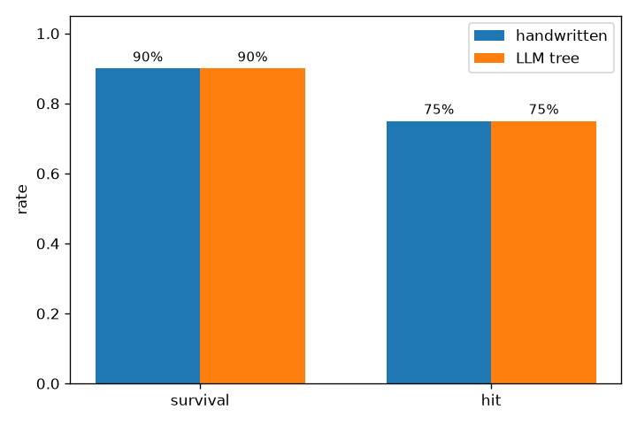

# 阶段二技术总结报告（D2.7-2）

> 项目：面向忠诚僚机超视距空战的知识数据双驱动无人智能及自迭代技术研究
> 阶段：阶段二（方案设计与技术预研，2026-07—2026-11）
> 日期：2026-11-01
> 范围：2.1–2.7 技术交付与验证结果；不包含阶段三 DRL/JSRL/多机训练。
> 状态：2.1–2.7 技术交付完成；M2.7 阶段二整体验收待指导教师签字（签字页 `docs/阶段二_2.7_指导教师审核签字页.md`）。

## 1. 阶段目标回顾

阶段二目标是完成超视距空战智能体的“环境—武器/传感器—标准化接口—可视化—LLM 行为树—引导策略”技术底座，为阶段三 DRL/JSRL 训练与多机扩展提供可运行、可测试、可追溯的工程基础。

计划书验收要点：

- 2.3 Gym 接口跑通、多实例吞吐 ≥1000 steps/s；
- 2.5 LLM 行为树生成-测试闭环跑通（通过率 >90%、OODA 覆盖 >95%、安全违规 0）；
- 2.6 两级优先级引导策略行为树可执行；
- 2.7 20 组态势验证、手写树存活率 >80%、安全违规 0、节点日志可追溯。

## 2. 技术路线

```
JSBSim F-104（六自由度）
        │
        ├─ 导弹 3DOF/TPN/APN + 雷达/RWR/MAWS（2.2）
        │
        ▼
BVRCombatEnv（Gymnasium，28 维观测，Dict/Flat 动作，1 Hz 决策）（2.3）
        │
        ├─ 可视化工具：2D 战术显示 / CSV / GIF / MP4 / ACMI（2.4）
        │
        ├─ LLM 行为树：Coder → Executor → Tester 迭代（2.5）
        │       └─ DeepSeek 在线 Round 1 收敛
        │
        └─ 两级优先级引导策略（2.6）
                ├─ 第一优先级：边界约束守卫（纯规则，不可绕过）
                ├─ 第二优先级：OODA 战术执行子树
                └─ GuideInterface（JSRL 引导/交还 DRL）
                        │
                        ▼
                20 组态势验证 + LLM/手写树对比（2.7）
```

核心设计原则：

1. **物理与决策解耦**：环境只负责 JSBSim/导弹/雷达推进，行为树/DRL 只输出 1 Hz 动作；
2. **安全优先**：边界约束在动作分发层覆盖，不依赖行为树 Selector 是否走到安全分支；
3. **接口与契约统一**：帧/info/CSV/ACMI/行为树 JSON 均有版本化契约；
4. **可追溯**：每步节点执行日志、边界触发日志、逐局 summary/CSV/ACMI 全量留存。

## 3. 交付物索引（2.1–2.7）

| 步骤 | 交付物 | 主要路径 | 状态 | 关键指标 / 证据 |
|:--:|--------|----------|:--:|-----------------|
| 2.1 | 机型选型与性能约束 | `多任务智能体/common/bvr_combat_env.py`、`JSBSim_培训与验证资料/` | ✅ | F-104 主选；+5/−2 G、M1.6、14,000 m、2×中距弹、雷达 ≤80 km；安全阈值已生效 |
| 2.2 | 导弹与雷达模型 | `common/missile_model.py`、`common/radar_model.py`、`common/README_战场要素.md` | ✅ | 3DOF 双推力 + TPN/APN + LAE/NEZ；火控雷达/RWR/MAWS；24 项单测 |
| 2.3 | 标准化 Gym 接口 | `common/bvr_combat_env.py`、`common/jsbsim_bridge.py`、`common/README_环境.md` | ✅ | 28 维观测 + Dict/FlatAction；`check_env` 通过；4 实例并行 1611 steps/s（≥1000） |
| 2.4 | 可视化方案 | `可视化工具/`、`docs/assets/2.4_demo/`、`docs/阶段二_2.4_可视化验证与使用说明.md` | ✅ | 2D 战术显示、CSV/GIF/MP4、ACMI；seed8 112 步命中、113 帧；可视化单测 23 项 |
| 2.5 | LLM 行为树生成器-测试器 | `引导策略行为树/llm_bt/`、`llm_bt_generator.py`、`prompts/`、`docs/阶段二_2.5在线收敛日志_20261101_r2.md` | ✅ | DeepSeek 在线 Round 1 收敛；通过率 100%（5/5）、OODA 100%、安全违规 0；行为树单测 26 项 |
| 2.6 | 两级优先级引导策略行为树 | `llm_bt/boundary_constraints.py`、`tactical_execution_tree.py`、`guide_interface.py`、`run_guidance_sim.py`、`docs/阶段二_2.6_引导策略行为树_实现与测试报告.md` | ✅ | 6 类边界约束 + OODA 8/8 战术树 + JSRL 接口；3 seeds × 240 步 0 违规；行为树测试 47 项 |
| 2.7 | 20 组态势仿真验证与阶段二总结 | `run_2_7_validation.py`、`docs/阶段二_2.7_行为树仿真验证报告.md`、`docs/assets/2.7_validation/` | ✅ 技术验证 | 手写树存活 90%（18/20）、命中 75%、误发射 0%、安全违规 0、trace 20/20；LLM 树同口径 90%/75%/0% |

回归测试：三套全量 **155 passed / 0 failed**（多任务智能体 80 + 行为树 52 + 可视化 23）。

## 4. 主要结果

### 4.1 环境与接口

- 单实例 `env.step` 约 2.2 ms；4 实例并行 1611 steps/s，满足 ≥1000 目标；
- 1000 episode 稳定性测试 1000/1000 完成，0 异常、0 非有限观测/奖励（127,901 步）；
- 固定 seed 可复现初始态势（距离、方位、高度、马赫）。

### 4.2 LLM 行为树闭环

- Coder（生成 JSON）→ 静态校验（BTGenBot 规则）→ Executor（py_trees + JSBSim）→ Tester（LLM 用例）闭环；
- 2.5 在线 DeepSeek `deepseek-chat` Round 1 收敛：通过率 100%（5/5）、OODA 覆盖 100%、安全违规 0；
- 修正了“提前 enemy_hit 因步数不足被判失败”的判据问题（仅豁免 `steps_executed >=/>`，安全/逻辑/未坠毁/交战/发射判据保持严格）；
- 离线 mock 闭环与在线真实调用均有归档日志，未用 mock 冒充在线。

### 4.3 两级优先级引导策略

- **第一优先级边界约束**：低高度、最小速度、过载、最大速度、禁飞区、低燃油 6 类规则；带滞回与触发日志；过载时限制 roll/pitch 步进；
- **第二优先级战术执行**：Human_Command / Self_Defense / Fuel_Return / BVR_Engagement（Detection/Engagement）/ Default_Patrol，OODA 8/8；
- **GuideInterface**：引导期内返回行为树动作，耗尽返回 `(None, False)`；支持课程式 `update_guide_steps` 与每 episode `reset`；
- 3 seeds × 240 步联调：0 安全违规、0 逻辑错误、OODA 执行覆盖 100%、引导比例 100%。

### 4.4 20 组态势验证与两树对比

| 指标 | 手写树（2.6） | LLM 树（2.5 r2） |
|------|--:|--:|
| 存活率 | **90%（18/20）** | **90%（18/20）** |
| 命中率 | 75%（15/20） | 75%（15/20） |
| 误发射率 | 0%（0/40） | 0%（0/39） |
| 安全违规 | 0 | 0 |
| 静态 OODA 覆盖 | 100% | 100% |
| 执行 OODA 覆盖均值 | 99.38%（19/20 局 8/8） | 99.38%（19/20 局 8/8） |
| node_trace 完整性 | 20/20 | 20/20 |
| 平均步数 | 88.2 | 88.3 |
| 终止分布 | 命中 15 / 超时 3 / 被命中 2 | 同左 |



结论：在相同环境、守卫、引导与 20 组态势下，两棵树核心指标持平；手写树满足存活率 >80% 与安全违规 0 的验收要求。2 局 `own_hit` 已分析为战术/导弹命中问题，非安全/逻辑/日志问题。

## 5. 风险与限制

| 风险/限制 | 影响 | 现状与应对 |
|-----------|------|------------|
| 样本量 20 组固定 seed | 结论统计代表性有限 | 明确为固定态势验证；阶段三扩大规模 |
| OODA 逐局覆盖 19/20 | seed 6 无敌弹告警未执行 `evade_missile` | 日志完整；20 局并集 8/8；报告如实说明 |
| 边界约束自然触发 0 次 | 20 局均在包线内 | 6 类约束由合成单测与 `--guard-demo` 禁区触发验证 |
| 单机 1v1 限制 | 无僚机/多机协同 | 多机/HVA 列为阶段三后续 |
| LLM 树只代表一次在线生成 | 不能外推所有 LLM 输出 | 保留生成/测试/收敛日志；可重复生成 |
| 2 局被命中 | 存活率未达 100% | 已超 80% 门槛；未为个别 seed 过拟合 |
| 未做 DRL/JSRL 训练 | 引导策略尚未与学习策略闭环 | GuideInterface 已就绪，阶段三接入 |

## 6. 阶段三衔接

1. **JSRL 训练循环**：以 `GuideInterface` 为引导动作源，补充课程衰减、引导步数调度与 DRL 策略交还；
2. **DRL 网络/训练**：沿用现有 ActionV1/PolicyProtocol 与 `control_mode=assisted` 稳定飞行基线；
3. **多机/忠诚僚机**：扩展环境与角色分配，复用行为树的任务/战术层；
4. **规模验证**：在 2.7 的 20 组基础上扩大态势集，加入 LLM 树 vs 手写树 vs DRL 三方对比；
5. **验收材料**：本报告与 2.7 验证报告作为阶段二技术附件，签字页待指导教师审核。

## 7. 结论

阶段二 2.1–2.7 技术交付完成：

- 环境、武器/传感器、Gym 接口、可视化工具链可用；
- LLM 行为树生成-测试闭环在线收敛；
- 两级优先级引导策略行为树可执行，安全约束与引导接口通过测试；
- 20 组态势验证手写树存活率 90%、安全违规 0、节点日志完整可追溯；
- 三套全量测试 155 项通过。

**阶段二技术目标达成；M2.7 整体验收待指导教师签字确认。**
